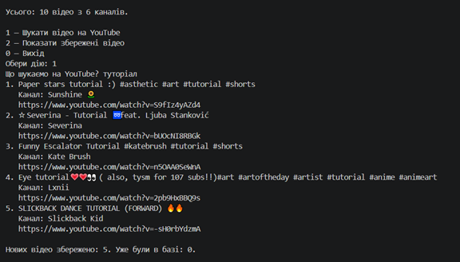
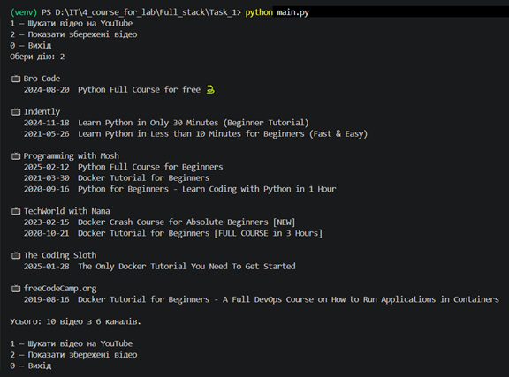
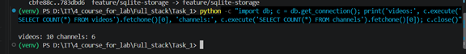
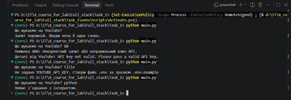
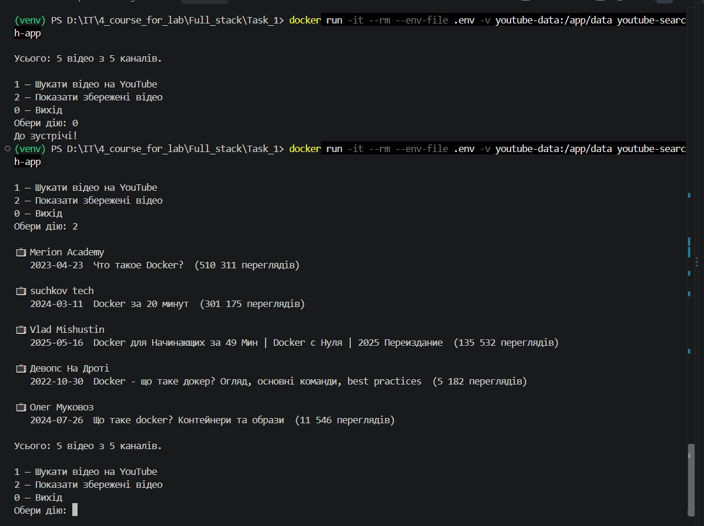

# YouTube Search App

Консольний застосунок на Python, який шукає відео через **YouTube Data API v3**,
зберігає результати в базу **SQLite** і показує збережене.

Проєкт для курсу «Full Stack + PM».

## Можливості
- Пошук відео за будь-яким запитом (параметр `q` змінює відповідь API)
- Збереження відео та каналів у дві пов'язані таблиці
- Повторний пошук **не створює дублікатів**
- Перегляд збережених відео, згрупованих за каналами
- Обробка помилок: немає мережі, неправильний ключ, вичерпана квота, порожній результат

## Технології
- Python 3.10+
- `requests`: HTTP-запити до API
- `python-dotenv`: читання налаштувань із `.env`
- `sqlite3`: вбудована база даних

## Структура бази даних

```
channels                      videos
---------------------         ------------------------------
id (PK)     TEXT        ◄──── channel_id (FK) TEXT
title       TEXT              id (PK)         TEXT
                              title           TEXT
                              published_at    TEXT
```

- Зв'язок **один до багатьох**: один канал має багато відео.
- Як первинні ключі використано id від YouTube (`channelId`, `videoId`), тож однакове відео не може бути збережене двічі.
- Вставка виконується через `INSERT ... ON CONFLICT DO UPDATE`: якщо запис уже є, оновлюється назва, і новий рядок не створюється.
- Усі SQL-запити параметризовані (`?`), що захищає від SQL-ін'єкцій.

## Як запустити

1. Клонувати репозиторій:
   ```powershell
   git clone https://github.com/Mariia2403/youtube-search-app.git
   cd youtube-search-app
   ```
2. Створити й активувати віртуальне середовище:
   ```powershell
   python -m venv venv
   .\venv\Scripts\Activate.ps1      # Windows (PowerShell)
   # source venv/bin/activate       # Linux / macOS
   ```
3. Встановити залежності:
   ```powershell
   pip install -r requirements.txt
   ```
4. Створити файл `.env` за зразком `.env.example` і вписати свій ключ:
   ```
   YOUTUBE_API_KEY=your_api_key_here
   DB_PATH=youtube.db
   ```
5. Запустити:
   ```powershell
   python main.py
   ```

## Як отримати ключ YouTube API
1. Зайти в [Google Cloud Console](https://console.cloud.google.com/) і створити проєкт.
2. **APIs & Services → Library** → знайти **YouTube Data API v3** → **Enable**.
3. **APIs & Services → Credentials → Create credentials → API key**.
4. Обмежити ключ: **API restrictions → Restrict key → YouTube Data API v3**.
5. Вставити ключ у `.env`.

> Для Google Cloud потрібна увімкнена двоетапна перевірка акаунта.

## Структура проєкту
```
├─ main.py          # меню, вивід результатів
├─ api.py           # запит до YouTube API, обробка помилок
├─ db.py            # SQLite: таблиці, збереження, вибірка
├─ .env.example     # шаблон налаштувань (без справжнього ключа)
├─ requirements.txt # залежності

```

## Обробка помилок
| Ситуація | Що бачить користувач |
|---|---|
| Порожній запит | «Запит порожній» |
| Немає ключа в `.env` | «Не задано YOUTUBE_API_KEY» |
| Немає інтернету | «Немає з'єднання з інтернетом» |
| Сервер не відповідає 10 с | «YouTube не відповідає» |
| Неправильний ключ (400) | повідомлення + деталі від YouTube |
| Вичерпано квоту (403) | повідомлення + деталі від YouTube |
| Помилка сервера (5xx) | «Проблема на боці YouTube» |
| Нічого не знайдено | «За цим запитом нічого не знайдено» |

## Безпека
- Ключ API зберігається в `.env`, який доданий до `.gitignore` і не потрапляє в репозиторій.
- Ключ обмежено лише YouTube Data API v3.
- Під час тестування ключ випадково потрапив на скриншот. Його одразу відкликано в Google Cloud і замінено новим, тож на скриншотах показано недійсний ключ.


## Тести
Автоматичні тести на `pytest` (12 тестів). Інтернет і ключ API для них не потрібні.

```powershell
pytest -v
```

- `tests/test_db.py`: збереження, відсутність дублікатів, FK, JOIN. Використовується база в пам'яті (`:memory:`), справжня `youtube.db` не змінюється.
- `tests/test_api.py`: обробка відповідей і помилок API. `requests.get` підмінено через `monkeypatch`, тож тести не витрачають квоту YouTube.


## Графічний інтерфейс
Окрім консольного меню (`python main.py`), є вікно на `tkinter`:

```powershell
python gui.py
```

Пошук (кнопкою або Enter), таблиця з переглядами й лайками, перегляд збереженого, подвійний клік відкриває відео в браузері.

## Запуск у Docker
Python і venv не потрібні, лише Docker Desktop.

```powershell
docker build -t youtube-search-app .
docker run -it --rm --env-file .env -v youtube-data:/app/data youtube-search-app
```

- ключ API передається під час запуску (`--env-file`) і не потрапляє в образ (`.env` у `.dockerignore`);
- база зберігається у volume `youtube-data` і не зникає після видалення контейнера.

## Скриншоти

**Пошук і збереження**


**Збережені відео з бази**


**Повторний пошук не створює дублікатів**


**Обробка помилок**


**Автоматичні тести**


**Графічний інтерфейс**


**Docker: дані зберігаються у volume**



